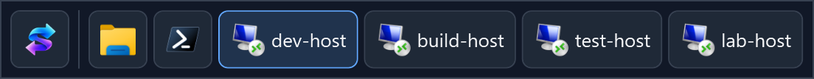

# EdgeSwitch


[](https://github.com/tamlok/edgeswitch/actions/workflows/ci.yml)

Switch between apps and Remote Desktop windows from a compact toolbar at the edge of your screen.



*Illustrative preview with fictional session names.*

## Download

**[Download EdgeSwitch for Windows x64](https://github.com/tamlok/edgeswitch/releases/latest/download/EdgeSwitch.exe)**

**[Portable ZIP with the Copilot plugin](https://github.com/tamlok/edgeswitch/releases/latest/download/EdgeSwitch-portable.zip)** — extract the entire ZIP into a writable folder. The standalone executable still works without plugins.

Requires **Windows 10/11 x64** and the **[.NET 10 Desktop Runtime (x64)](https://dotnet.microsoft.com/en-us/download/dotnet/10.0)**. The runtime is **not bundled**.

Run `EdgeSwitch.exe`—there is no app installer. The executable is unsigned, so Windows may display a reputation warning.

## Use

Run EdgeSwitch on the computer where your Remote Desktop client windows are open. By default, it appears on the left edge and includes Remote Desktop Connection (`mstsc.exe`) and Remote Desktop (`msrdc.exe`).

Rest the pointer against the part of the screen edge where the toolbar appears. It opens after a short pause; the rest of the edge does not trigger it.

| Action | What it does |
| --- | --- |
| Click an app icon or session name | Switch to that window, restoring it if minimized. |
| Left-click the EdgeSwitch icon | Minimize local windows to show the host desktop. Remote Desktop sessions stay open. |
| Right-click the EdgeSwitch icon | Open Settings. |
| Press **Esc** or **Alt+F4** | Hide the toolbar. |

The desktop action is not a toggle—select an app or session entry to restore it. After hiding the toolbar, move outside its edge segment before hovering there again.

The notification-area menu provides **Show toolbar**, **Settings**, and **Exit EdgeSwitch**. Check Windows' **Show Hidden Icons** if you cannot see it.

## Settings

- **Apps:** select which applications to include, or use **Add / Browse** for other executables. Both Remote Desktop clients are listed even when they are not running. “Capture” selects windows; it does not record your screen.
- **Position:** choose from 12 centered or corner-aligned locations. **Top-left** is horizontal; **Left-top** is vertical.
- **Display:** Automatic ignores seams between monitors. Select a specific display to allow its shared edges.
- **Hide delay:** adjust how quickly the toolbar hides when idle.
- **Always maximize remote desktop sessions:** on by default. When enabled, clicking a desktop-session entry for `mstsc.exe` or `msrdc.exe` requests the same action as its title-bar Maximize button. The remote client controls whether maximizing enters fullscreen. Already-maximized or fullscreen sessions stay unchanged; ordinary apps, connection dialogs, and RemoteApps are not resized. This does not apply just by revealing the toolbar. Explicit maximize-off and app selections in the INI are respected.
- **Plugins:** enable trusted toolbar indicators and configure their fields. Plugins are off by default and start only after **Save**.
- **Startup:** enable **Start EdgeSwitch when I sign in** to launch automatically when you sign in to Windows. Off by default; applies only to your account and needs no administrator rights.

Choose **Save** to apply your changes; **Cancel** leaves them unchanged. Toolbar settings are stored in `settings.ini` alongside `EdgeSwitch.exe`. The startup preference uses the `EdgeSwitch` entry under `HKEY_CURRENT_USER\Software\Microsoft\Windows\CurrentVersion\Run`.

If you move the portable executable, run it from the new location and choose **Save** with startup enabled to update its path. Disable startup and save before deleting the executable. Windows **Startup Apps** can independently block automatic launch; if disabled there, re-enable EdgeSwitch there as well.

### Portable settings file

`settings.ini` is created when you choose **Save**, not on first launch. Keep it beside `EdgeSwitch.exe` when moving or copying the app. The executable's folder must be writable; save failures are reported rather than falling back to a user-profile folder. The launch working directory does not affect the settings path.

```ini
[Toolbar]
Edge=Left
MonitorDeviceName=
HideDelayMilliseconds=700
MaximizeOnActivate=true

[CapturedProcesses]
0=mstsc
1=msrdc
```

- `Edge` uses the location names `Left`, `Top`, `Right`, `Bottom`, `LeftTop`, `LeftBottom`, `TopLeft`, `TopRight`, `RightTop`, `RightBottom`, `BottomLeft`, or `BottomRight`.
- An empty `MonitorDeviceName` means Automatic. The Settings dialog writes the selected display's device name.
- `HideDelayMilliseconds` accepts integers from 200 to 5000; `MaximizeOnActivate` accepts `true` or `false`.
- `[CapturedProcesses]` uses unique nonnegative integer keys, read in numeric order, with one executable name or path per value. An empty section captures nothing; an absent section uses the default clients. Missing toolbar keys also use defaults.
- The file is UTF-8. Section/key names are case-insensitive; surrounding whitespace and full-line `;` or `#` comments are accepted. Values have no inline comments, so commas, semicolons, and `=` in executable names are preserved. Unknown sections/toolbar keys are ignored; duplicate keys and invalid supported values are rejected.

Edit the INI while EdgeSwitch is closed. Invalid or unreadable files produce a warning and defaults without overwriting the file. Choosing **Save** rewrites supported settings; comments and unknown entries are not preserved.

The former `%LOCALAPPDATA%\EdgeSwitch\settings.json` is no longer read or imported and is left untouched. Reapply previous preferences in Settings and choose **Save** to create the portable INI. Windows startup registration remains per-user in the registry, not in this file.

## Plugins

Plugins live in `plugins/<id>/` beside `EdgeSwitch.exe`. Each folder contains `plugin.json` and any scripts or executables it needs. Install or update plugins while EdgeSwitch is closed. Open **Settings**, review the plugin's fields, check its name, and **Save**. **Cancel** neither starts plugins nor changes their settings.

Plugins run as your Windows user, **not in a security sandbox**. They can read files, access credentials and make network requests. Only install and enable code you trust. EdgeSwitch isolates process lifetime: each enabled plugin polls independently, with no overlapping runs; disabling it, saving new settings or exiting cancels its process tree. A hung or failed plugin shows **Unavailable** instead of retaining a stale percentage.

### Copilot AI-credit usage

The bundled plugin requires **PowerShell 7 (`pwsh.exe`)** and **GitHub CLI (`gh`)**, not the Copilot SDK. Install [PowerShell 7 using the MSI installer](https://learn.microsoft.com/powershell/scripting/install/installing-powershell-on-windows#installing-the-msi-package) so the host can launch a real executable directly rather than a Microsoft Store execution alias. Ensure `pwsh.exe` is on `PATH` and restart EdgeSwitch after installation. There is no fallback to Windows PowerShell 5.1. Install a current [GitHub CLI](https://cli.github.com/) with multi-account `gh auth token --user` support, then check the runtime and sign in:

```powershell
pwsh --version
gh auth login --hostname github.com
gh auth status --hostname github.com
```

In EdgeSwitch Settings, enable **Copilot** and enter:

- **GitHub host:** `github.com`, or your enterprise's hostname under `ghe.com` for Enterprise Cloud with data residency.
- **GitHub username:** the exact account to read. For an Enterprise Managed User, include its enterprise shortcode. For a `ghe.com` account, use that same hostname with `gh auth login` and `gh auth status`.

Personal and managed accounts use their **own authenticated quota**, not an administrator's organization billing report. The plugin selects stored credentials by host and username and verifies the returned identity before reading usage. It does not change `gh`'s active account or store tokens in `settings.ini`. Inherited token environment variables are ignored inside the plugin to prevent silently reading another account. Enterprise authentication, SSO and Copilot policies still apply.

The toolbar shows **AI credits used / cycle allowance × 100** to one decimal place. For example, `29,326 / 1,000,000` displays **2.9%**. Hover for the selected account, usage, allowance, quota-reset date and fetch time. Readings refresh every five minutes; saving Settings triggers a fresh reading. Overage can exceed 100%. Unlimited allowance displays **Unlimited**; missing or invalid quota and legacy request-based billing display **Unavailable**, never an invented credit percentage.

**API caveat:** this lightweight integration uses GitHub's undocumented `/copilot_internal/user` quota endpoint. Its schema or permissions can change. It requires an AI-credit snapshot with `token_based_billing`, `credits_used` and `entitlement`; it does not infer an allowance from the plan name. Managed-account access has not been verified against a live EMU credential.

If unavailable, hover for the reason and check the configured account, `gh auth status`, network access, enterprise authorization and Copilot entitlement. Script execution must be allowed by your Windows/organization policy; EdgeSwitch does **not** bypass execution policy. Review downloaded scripts before unblocking them where your policy permits. Missing plugin files remain visible as an unavailable indicator when enabled.

### Writing a toolbar plugin

The process protocol is language-independent: PowerShell, Python, Node.js or a compiled program can implement it. A manifest example:

```json
{
  "protocolVersion": 1,
  "name": "My indicator",
  "description": "Describe the measurement and any prerequisites.",
  "executable": "pwsh.exe",
  "arguments": ["-NoProfile", "-NonInteractive", "-File", "indicator.ps1"],
  "refreshSeconds": 300,
  "timeoutSeconds": 30,
  "settings": [{"key": "Source", "label": "Source", "defaultValue": ""}]
}
```

- The folder name is the plugin ID. IDs and setting keys use 1–64 ASCII letters, digits, `_` or `-`.
- Discovery reads metadata only; it never executes installed plugins. Malformed manifests do not stop other plugins.
- No shell is inserted. Arguments are passed individually; the working directory is the plugin folder. Relative executable paths resolve there first; bare executable names otherwise use the normal Windows executable search. Use an explicit path when executable identity matters.
- Refresh is 30–86,400 seconds **after the previous run finishes**. Timeout is 1–120 seconds and cannot exceed refresh. The host closes the process job on timeout, disable, reload and exit, including descendants that retain pipe handles.
- Read one UTF-8 JSON request from standard input, then EOF: `{"protocolVersion":1,"settings":{"Source":"configured value"}}`. Settings are single-line text, not a secret store.
- Write exactly one UTF-8 JSON object to standard output and exit successfully: `{"protocolVersion":1,"text":"42.1%","toolTip":"Explain the reading and when it was measured."}`. Do not print progress to stdout. No commands or links in the response are executed.
- `text` is required, nonblank, single-line and at most 64 characters; `toolTip` is required and at most 4,096 characters. Long labels/text are visually trimmed. Each stdout/stderr stream and the request are capped at 16 KiB; stderr is not displayed. `plugin.json` is limited to 32 KiB, 32 arguments and 32 settings.

Plugin preferences are kept in the portable INI:

```ini
[Plugins]
copilot=true

[Plugin.copilot]
GitHubHost=github.com
GitHubUser=YOUR_LOGIN
```

Section/key names are case-insensitive. Surrounding option whitespace is trimmed consistently when saving and applying settings. Duplicate keys and multiline/NUL values are rejected. An options-only section does not enable its plugin. Preferences for temporarily missing plugins survive Save; missing or malformed plugins cannot be newly enabled in Settings.

## Good to know

- If only the EdgeSwitch icon appears, check the selected apps in Settings and choose **Save**.
- Each window gets its own entry. Multiple sessions kept as tabs inside one window appear as a single entry.
- Hover over an entry to see its full window title.
- EdgeSwitch is intended for regular app and Remote Desktop fullscreen windows. Windows lock/UAC screens and exclusive-fullscreen games can block the toolbar or window switching.
- EdgeSwitch maximizes sessions without injecting keyboard shortcuts or changing held modifier keys. A maximized window counts as success even if the remote client does not enter fullscreen. If the request fails, try the session's Maximize button directly.

## Build from source

On Windows with the **.NET 10 SDK** installed:

```powershell
dotnet build EdgeSwitch.csproj -c Release
.\bin\Release\net10.0-windows\EdgeSwitch.exe
```

Check native maximize behavior and window guards on an idle interactive desktop using .NET 10 PowerShell. This uses disposable windows, not a connected RDP session:

```powershell
pwsh -NoProfile -STA -File tests/MaximizeWindowSmoke.ps1
```

Check INI parsing, executable-relative storage, and save/startup rollback in isolated file and registry locations:

```powershell
pwsh -NoProfile -File tests/SettingsStoreSmoke.ps1
```

Check Copilot quota edge cases without credentials or network access, and plugin subprocess isolation/lifecycle with disposable processes:

```powershell
pwsh.exe -NoProfile -NonInteractive -File tests/CopilotPluginSmoke.ps1
pwsh -NoProfile -STA -File tests/PluginSmoke.ps1
```
